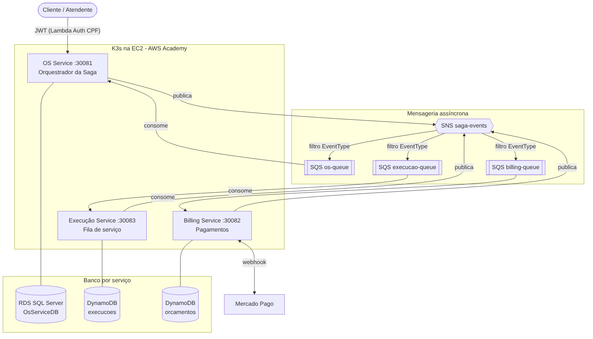
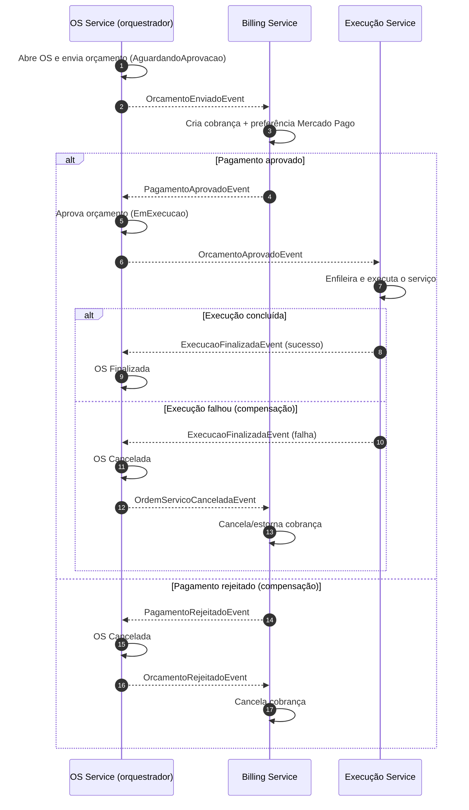

# Oficina Mecânica Wagyu — Relatório da Fase 4 (Tech Challenge FIAP)

> Conteúdo base para o PDF de entrega. Preencher os campos marcados com `[ ]`.

## 1. Integrantes
- [Nome completo] — [RM] — [Discord/e-mail]

## 2. Repositórios
| Microsserviço | Repositório |
|---|---|
| OS Service (orquestrador da Saga, SQL Server) | https://github.com/Rogeraugusto23/oficina-os-service |
| Billing Service (pagamentos, DynamoDB) | https://github.com/Rogeraugusto23/oficina-billing-service |
| Execução Service (fila de serviço, DynamoDB) | https://github.com/Rogeraugusto23/oficina-execucao-service |
| Infraestrutura (Terraform + K3s) | https://github.com/Rogeraugusto23/oficina-wagyu-infra-k8s |

## 3. Arquitetura

- **Execução:** K3s em EC2 (AWS Academy), um namespace e um Deployment (2 réplicas + HPA) por microsserviço, exposto via NodePort (OS 30081, Billing 30082, Execução 30083).
- **Dados:** cada serviço tem seu próprio banco; nenhum serviço lê o banco de outro.
  - OS Service: **SQL Server** (RDS), pois o domínio é relacional (cliente, veículo, OS, serviços, peças) e exige transações.
  - Billing e Execução: **NoSQL (DynamoDB)**, pois são agregados simples, acessados por chave, com escrita/consulta por documento.
- **Comunicação:** assíncrona por eventos de integração em **SNS (um tópico) → SQS (uma fila por serviço)**, com filtro por atributo `EventType`. Não há chamada HTTP síncrona entre os serviços.
- **Autenticação:** JWT HS256 com segredo compartilhado (emitido pela Lambda de login por CPF da Fase 3).
- **Observabilidade:** logs estruturados (Serilog JSON) com `CorrelationId` = Id da OS, propagado em todos os eventos, permitindo rastrear uma OS entre os serviços.
- **CI/CD:** um pipeline por repositório (build → testes com cobertura → quality gate → build da imagem → deploy no K3s), branch `main` como único caminho para produção.

## 4. Saga Pattern

### Estratégia: Saga **orquestrada** (orquestrador = OS Service)
O OS Service (`SagaOrchestrator`) mantém o estado da OS e decide o próximo passo a partir dos eventos recebidos. Billing e Execução só reagem a eventos e respondem com outros eventos.

| Evento | Publicado por | Consumido por | Efeito |
|---|---|---|---|
| OrcamentoEnviadoEvent | OS | Billing | Cria cobrança e link do Mercado Pago |
| PagamentoAprovadoEvent | Billing | OS | OS passa a EmExecucao |
| PagamentoRejeitadoEvent | Billing | OS | **Compensação:** OS Cancelada |
| OrcamentoAprovadoEvent | OS | Execução | Enfileira a execução |
| ExecucaoFinalizadaEvent (sucesso) | Execução | OS | OS Finalizada |
| ExecucaoFinalizadaEvent (falha) | Execução | OS | **Compensação:** OS Cancelada |
| OrdemServicoCanceladaEvent / OrcamentoRejeitadoEvent | OS | Billing | **Compensação:** cobrança Cancelada |

### Por que orquestrada e não coreografada
1. **O fluxo é sequencial e de regra de negócio centralizada:** aprovar → pagar → executar → finalizar, com a OS como entidade central. Um ponto único que conhece o fluxo facilita entender e testar.
2. **Compensações explícitas:** é o orquestrador quem decide cancelar a OS e ordenar o cancelamento da cobrança. Na coreografia essa lógica ficaria espalhada, com risco de ciclos de eventos.
3. **Visibilidade:** o estado da Saga é o próprio status da OS, consultável em um único lugar (útil na demonstração e no suporte).
4. **Acoplamento aceitável:** os serviços participantes não conhecem uns aos outros, só os contratos de evento.

**Trade-off assumido:** o orquestrador é um ponto central de lógica. Mitigamos com handlers idempotentes (eventos fora de ordem ou duplicados são ignorados quando o status da OS não bate) e fila SQS com reentrega.

### Cenários cobertos (testados em produção no K3s)
- Caminho feliz: OS Finalizada.
- Pagamento rejeitado: OS Cancelada.
- Falha na execução após pagamento: OS Cancelada e cobrança Cancelada (estorno).

## 5. Justificativa da divisão em microsserviços
- **OS Service:** dono do ciclo de vida da OS, clientes e veículos. É o núcleo do negócio e o único que precisa de consistência transacional relacional. Também orquestra a Saga.
- **Billing Service:** responsabilidade distinta (dinheiro), com integração externa (Mercado Pago), requisitos próprios de segurança (webhook com segredo) e padrão de acesso por chave. Isolar reduz o impacto de falhas/instabilidade do provedor de pagamento e o escopo de auditoria.
- **Execução Service:** representa o trabalho da oficina (fila, início, fim, falha). Escala e evolui em ritmo diferente (por exemplo, futuro app do mecânico) e não precisa do banco relacional.
- **Limites (bounded contexts):** cada serviço tem seu modelo, banco, pipeline e deploy independentes; mudanças em um não obrigam redeploy dos outros.
- **Por que 3 e não mais:** granularidade suficiente para demonstrar Saga e bancos distintos sem criar sobrecarga operacional desnecessária para o tamanho do domínio.

## 6. Qualidade
- Clean Architecture em cada serviço (Domain / Application / Infrastructure / API).
- Testes unitários de domínio e casos de uso, testes da Saga com fakes de mensageria e testes BDD (Gherkin) do fluxo completo.
- Cobertura de linhas de Domain+Application ≥ 80%, medida e exibida no pipeline.
- SonarQube/SonarCloud integrado ao pipeline (ativado quando `SONAR_TOKEN` está configurado).

## 7. Débitos técnicos conhecidos (declarados)
- DynamoDB: buscas por atributos secundários usam `Scan`; em produção usaríamos GSI.
- Webhook do Mercado Pago simplificado (sem validação de assinatura HMAC oficial); sem AccessToken o Billing opera em modo simulado.
- Sem Outbox Pattern: publicação do evento ocorre após o commit; falha entre os dois passos exigiria reconciliação.
- Segredo JWT compartilhado (em produção: chave assimétrica/IdP).
- Ambiente AWS Academy (credenciais temporárias, sem Load Balancer, NodePort).
- Pipeline de Terraform (repositório de infraestrutura) depende de credenciais AWS temporárias do Learner Lab: o job `Plan/Apply` falha quando elas expiram, e a infraestrutura é aplicada manualmente a cada novo lab.
- Sem IP fixo (Elastic IP não é permitido no Learner Lab): o IP público da EC2 muda quando o lab reinicia.
